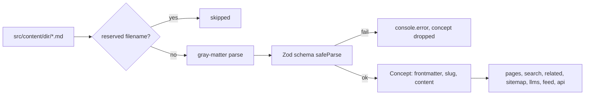

# The OKF content bundle

`src/content/` is **both** the site's content source and an [Open Knowledge Format](https://github.com/GoogleCloudPlatform/knowledge-catalog/tree/main/okf) v0.2 bundle (`OKF_VERSION` in `src/lib/okf.ts`). It is not an export, so what agents read and what visitors see cannot drift. Every non-reserved `.md` file is a *concept* with YAML frontmatter and a non-empty `type`.

Consult this page when adding a content type or field, changing validation, or touching how pages read content.

## Directory ↔ type ↔ URL

The registry lives in `src/lib/schemas.ts` (`DIR_TO_TYPE`, `DIR_TO_URL`, `SCHEMAS`); section metadata lives in `src/lib/site.ts` ([overview](overview.md)).

| Directory | `type` | URL | Schema |
| --- | --- | --- | --- |
| `guidance/` | `policy` | `/guidance/<slug>` | `policySchema` |
| `writing/` | `post` | `/writing/<slug>` | `postSchema` |
| `presentations/` | `presentation` | `/presentations/<slug>` | `presentationSchema` |
| `software/` | `software` | `/software/<slug>` | `softwareSchema` |
| `open-adaptive-district/` | `protocol` | `/open-adaptive-district/<slug>` | `protocolSchema` (see [OAD](open-adaptive-district.md)) |
| `use-cases/` | `use-case` | `/use-cases/<category>/<slug>` | `useCaseSchema` |
| `tools/` | `tool` | `/tools/<slug>` | `toolSchema` |
| `articles/` | `research` | `/articles/<slug>` | `researchSchema` |

`OKF_TYPES` in `src/lib/okf.ts` is a closed vocabulary. All concepts extend `okfBase`: required `type`, `title`, `description`, `resource` (must start with `/`); optional `tags`, `sources`, `generated`, `verified`, `status` (`draft|stable|deprecated`, default `stable`), `stale_after`. Field tables for authors are in [docs/CONTENT.md](../../docs/CONTENT.md).

Naming constraints that bite: OKF reserves `type` and `status`, so presentations/research/tools carry their genre in `format`, and tools carry Production/Experimentation in `maturity`. Software `maturity` is `Production|Pilot|Beta|Retired`, and `getCounts().softwareInProduction` counts only `Production`.

## Loading

*Lenient at runtime: a malformed file disappears from the site rather than crashing a render.*

`src/lib/content.ts` is the only sanctioned reader: `getConcepts(dir)` and `getConcept(dir, slug)` (both `react/cache`d; `getConcept` rejects slugs containing `/`, `\\` or `..`), plus `byDateDesc`, `collectTags`, and `getCounts()`. Reading `src/content` with `fs` directly pulls in `index.md`/`log.md` as ghost entries (the one exception is the raw-file route `src/app/okf/[...path]/route.ts`, see [machine-readable surfaces](machine-readable-surfaces.md)). Counts shown anywhere on the site must come from `getCounts()`: the site rule is "never invent a number".

Derived views built on the loader: `src/lib/all-content.ts` (`getAllConcepts`, flat list for machine routes; `indexable` drops drafts; `STATIC_ROUTES`), `src/lib/search.ts` (title/description/tag/body index), `src/lib/related.ts` (scored cross-type links), `src/lib/use-cases.ts`, `src/lib/oad.ts`. Note the `DIRS` list is duplicated in `all-content.ts`, `search.ts` and `related.ts`: adding a content directory means updating all three plus `DIR_TO_TYPE`.

## Strict validation (CI gate)

`scripts/content-validate.ts` (`bun run content:validate`) runs three passes:

1. Parse and conformance: frontmatter present and parseable, `type` non-empty, known, and matching its directory; duplicate slugs; registers each `resource` as a known path.
2. Schema, lifecycle warnings (draft, past `stale_after`, long description), `image`/`thumbnail` must exist under `public/`, body links: `*.md` bundle links must resolve, site-absolute links must hit a known concept path or a file in `public/`.
3. Index freshness: each `<dir>/index.md` must list exactly the current slugs, and the bundle root must have no non-reserved `.md`.

It is also the repo's "test" for content (CI and `psd-ci.yml` use it as the test command; see [CI and deploy](../operations/ci-and-deploy.md)).

## Reserved files

`index.md` and `log.md` are generated by `scripts/okf-build.ts` (`bun run okf:build`): never hand-write them. The bundle root index carries `okf_version`; `log.md` is built from git history. Re-run after adding or removing a concept, or validation fails on stale indexes.

## Change recipes

**Add a content type**: add the string to `OKF_TYPES` (`src/lib/okf.ts`); add a schema, `SCHEMAS` entry, `DIR_TO_TYPE` and `DIR_TO_URL` entries (`src/lib/schemas.ts`); add the section to `src/lib/site.ts` (`SECTIONS` or `PRACTICE_SECTIONS`); extend `DIRS` in `all-content.ts`, `search.ts`, `related.ts`; add `DIR_TITLES`/`DIR_BLURBS` in `scripts/okf-build.ts` and ordering in `src/app/llms.txt/route.ts`; add `CONCEPT_DIRS` in `next.config.js` so `.md` and `Accept: text/markdown` rewrites work; add list and `[slug]` pages under `src/app/`; document in `docs/CONTENT.md`. Validate: `bun run okf:build && bun run content:validate && bun run type-check`, then `bun run build` and the audits (conditional: routes changed) from [CI and deploy](../operations/ci-and-deploy.md).

**Add an optional field**: extend the type's schema in `schemas.ts` only; no migration needed. Required fields would break every existing file, so run `content:validate` to see them all.

**Never**: rename a slug (it is the permanent URL), or tidy use-case category URLs (spaces and `&`, URL-encoded, are load-bearing).

## History note

`scripts/content-migrate.ts` was a one-time frontmatter migration to OKF v0.2 (body bytes preserved; `type`→`format`, `status`→`maturity`; descriptions/dates/tags derived from content or git). [docs/derived-frontmatter.md](../../docs/derived-frontmatter.md) lists values that were derived rather than authored and still wait for human review. Not part of the build.
