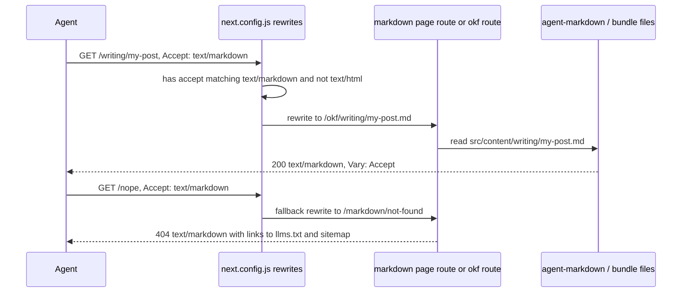

# Machine-readable surfaces

The site's stated purpose is to be read by other districts and their agents, so these surfaces are product features, not add-ons ([AGENTS.md](../../AGENTS.md) says to keep them working). They all derive from the single concept loader described in [the content bundle](content-bundle.md); `src/lib/all-content.ts` (`getAllConcepts`) gives the machine routes one shared flat view so they cannot drift, which is how the old sitemap came to advertise non-existent `/about` and `/contact`.

| Surface | Implementation | Notes |
| --- | --- | --- |
| `/llms.txt` | `src/app/llms.txt/route.ts` | Index of links with one-line descriptions, ordered by `ORDER`. `revalidate = 3600`. Must not inline bodies. |
| `/llms-full.txt` | `src/app/llms-full.txt/route.ts` | Every non-draft document with a small header, opt-in heavy fetch. |
| `/okf`, `/okf/<dir>/<slug>.md` | `src/app/okf/[...path]/route.ts`, `src/app/okf/page.tsx` | Raw markdown from the bundle (including `index.md`, `log.md`). Guards: max two segments, no `..`, allowed dirs only (`DIR_TO_TYPE` keys), resolved path must stay inside `src/content`. `force-static` with `generateStaticParams`. |
| `/<section>/<slug>.md` | `next.config.js` `rewrites().beforeFiles` | Rewrites to `/okf/...`; the use-cases rule comes first because of the extra category segment. |
| `Accept: text/markdown` | `next.config.js` (`WANTS_MARKDOWN`) + `src/app/markdown/[page]/route.ts` + `src/lib/agent-markdown.ts` | `/` → `homeMarkdown()`, `/about\|contact\|privacy` → trust page body (from `src/lib/trust-pages.ts`), concept URLs → their `.md`, any would-be 404 → `notFoundMarkdown()` with status 404 via the `fallback` rewrite. |
| `/api/content.json` | `src/app/api/content.json/route.ts` | Typed manifest (no bodies), CORS open, `markdown` pointer per entry. |
| `/sitemap.xml`, `/feed.xml` | `src/app/sitemap.xml/route.ts`, `src/app/feed.xml/route.ts` | Generated from concepts plus `STATIC_ROUTES`. RSS covers every content type. |
| `/robots.txt` | `src/app/api/robots/route.ts` via `afterFiles` rewrite | Explicitly allows AI crawlers (repeating `Disallow: /search` in each named group) and points at the machine surfaces. |

## Content negotiation flow

*Negotiated requests are rewritten to the same handlers that serve `.md` paths.*

`markdownResponse` sets `Content-Type: text/markdown`, `Vary: Accept`, a one-hour `s-maxage`, and open CORS. Rewrites that read `.md` slugs must precede the negotiation rules, or `my-post.md` would be read as a slug.

## Redirect contract

`next.config.js` `redirects` (308 permanent) preserve pre-redesign URLs: `/blog` → `/writing`, `/policies` → `/guidance`, `/aistudio` → `/software/ai-studio`, `/openadaptivedistrict` and its `index.html` → `/open-adaptive-district`, and the archived action-plan URL → `/open-adaptive-district/action-plan`. Deliberately **not** redirected: `/tools`, `/articles`, `/use-cases` (92 of ~200 pages). Do not add a `:path*` wildcard under `/openadaptivedistrict`: the printable pages ([OAD](open-adaptive-district.md)) and the `first-draft/` archive must keep resolving.

`scripts/links-audit.ts` reads the pre-redesign content tree from a pinned git baseline (`BASELINE = 'e776864'`, with `assertBaseline` guarding against silent under-coverage), rebuilds each old URL and fetches it against a running server; a 3xx passes only if it lands on a 200. It needs full git history, which is why CI checks out with `fetch-depth: 0`. `scripts/agent-audit.ts` tests negotiation, `Vary`, markdown 404s, homepage metadata/JSON-LD and the trust pages over real HTTP.

## Change navigation

- **Adding a route**: if it should be in the sitemap, add to `STATIC_ROUTES` in `all-content.ts` (must be a real page; `links:audit` fetches each). If it needs a markdown twin, extend `generateStaticParams` and `TRUST_PAGES`/`agent-markdown.ts`.
- **Adding a concept directory**: add it to `CONCEPT_DIRS` in `next.config.js` or `.md` and negotiation silently stop working for it ([recipe](content-bundle.md#change-recipes)).
- **Renaming or moving a public URL**: add a redirect in `redirects`; `links:audit` covers new entries automatically.
- **Trust pages** (`/about`, `/contact`, `/privacy`) have one markdown body serving both HTML (`TrustPage` component) and markdown. The privacy text describes real data collection (Google Analytics in `src/app/layout.tsx`, the [Field Notes](../integrations/field-notes-newsletter.md) driver): change code and text together.
- Validation: `bun run type-check` for edits; routes/rewrites/redirects changes are conditional on `bun run build && bun run start` plus `bun run links:audit` and `bun run agent:audit` (see [CI and deploy](../operations/ci-and-deploy.md)).
