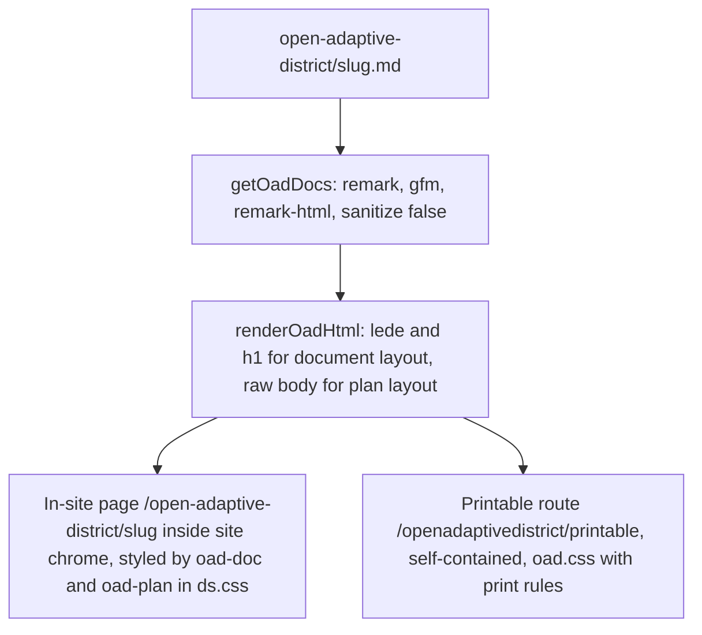

# Open Adaptive District (section 05)

The Open Adaptive District (OAD) is the district's six-week-cycle protocol for AI work. Its documents are OKF concepts of type `protocol` in `src/content/open-adaptive-district/` (schema `protocolSchema` in `src/lib/schemas.ts`, see [content bundle](content-bundle.md)): five reading-order documents (`n: '01'`..`'05'`, e.g. `start-here`, `get-started`, `playbook`, `deep-dive`, `what-were-learning`) and the fellowship `action-plan` (no `n`, `layout: plan`).

## Dual rendering

*Both shapes share one HTML string so they cannot drift.*

- `src/lib/oad.ts`: `getOadDocs` (sorted by `n`, plan last), `getOadSeries` (docs with `n`), `getOadDoc(slug)`, `getOadPrintable(file)`. Headings h2–h4 get slug ids. HTML is **not sanitised** because bodies are committed by staff, never user input.
- In-site: `src/app/open-adaptive-district/[slug]/page.tsx` (`data-section="oad"`, prev/next pager for the series only) and the index `page.tsx` (uses `OadCycle`).
- Printable: `src/app/openadaptivedistrict/[file]/route.ts`; `force-static`, `dynamicParams = false`, params from each doc's `printable`. Includes canonical link to the in-site page. Do not confuse the two spellings: hyphenated is the site, unhyphenated is the legacy static URL space.

## Invariants and gotchas

- **Never rename a `printable` value** (pattern `NN-Name.html`); `bun run links:audit` checks those URLs, and redirects in `next.config.js` deliberately avoid a wildcard there ([redirects](machine-readable-surfaces.md#redirect-contract)).
- **Copy buttons**: a `

` placed directly before a blockquote template becomes a copy button via `OadCopyButtons` (client component; the Playbook has three).
- **Action plan**: its body is its own designed markup and must remain **one HTML block with no blank lines**; a blank line ends the HTML block and the remainder is parsed as markdown (indented lines become code).
- **Two stylesheets, one class vocabulary**: `public/openadaptivedistrict/oad.css` (printable) and `.oad-doc` / `.oad-plan` in `src/styles/ds.css` (in-site). Change them together.
- `public/openadaptivedistrict/first-draft/` is an 18-file archive of the superseded original, kept in its own visual style on purpose. Do not restyle it (it is also in `.prettierignore`). Its old action-plan URL redirects to `/open-adaptive-district/action-plan`.
- `OAD_CONTACT_FORM` (Google Form) is used in place of a published email.

## Change navigation

Start at `src/lib/oad.ts`. Adding a document: copy an existing file in `src/content/open-adaptive-district/` and set `n`, `label`, `printable` and `layout`, then `bun run okf:build && bun run content:validate`. Do not use `content:new --type protocol`: `scripts/content-new.ts` has no `protocol` case, so the scaffold omits the required `label` and fails its own schema check (see [publishing workflow](../workflows/publishing-content.md)). Confirm printable URL after `bun run build && bun run start` with `bun run links:audit` (conditional: only when `printable` values or routes change).
