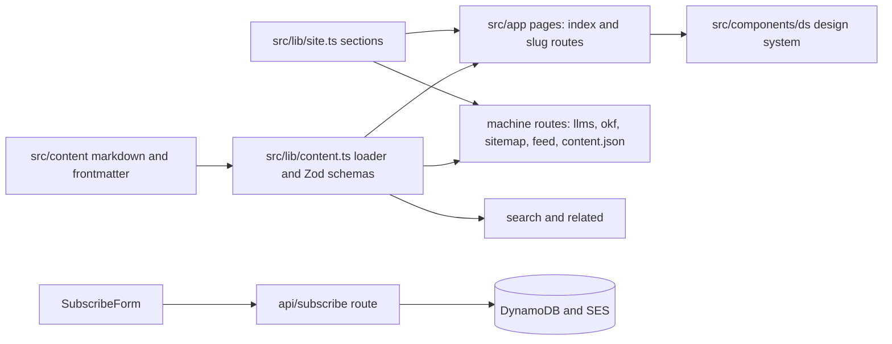

# Architecture overview

psd401.ai is Peninsula School District's public record of its AI work: a Next.js 16 App Router site (React 19, strict TypeScript, Tailwind v4, no component library) with **no database for content**. Markdown files in `src/content/` are rendered at build time and double as an agent-readable bundle ([content bundle](content-bundle.md)). The only runtime backend is the [Field Notes newsletter](../integrations/field-notes-newsletter.md) on AWS (DynamoDB + SES). Hosted on AWS Amplify (SSR) ([CI and deploy](../operations/ci-and-deploy.md)).

*Content flows one way: files → loader → pages and machine surfaces.*

## Sections

`src/lib/site.ts` is the single source of truth for navigation, breadcrumbs, sitemap, llms.txt and `resource` paths. Five permanently numbered sections appear in the masthead (`SECTIONS`): 01 Guidance, 02 Writing, 03 Presentations, 04 Software, 05 Open Adaptive District. **Never renumber.** The "reference library" (`PRACTICE_SECTIONS`, hub `/practice`: use cases, tools, research) is deliberately footer-linked and unnumbered, and its URLs are unchanged from before the 2026 redesign.

## Route map (`src/app`)

| Area | Routes | Notes |
| --- | --- | --- |
| Section lists + details | `guidance`, `writing`, `presentations`, `software`, `tools`, `articles` each with `page.tsx` + `[slug]/page.tsx` | `generateStaticParams` from `getConcepts`; `generateMetadata` uses `resource` as canonical and falls back to `DEFAULT_OG_IMAGE`. |
| Use cases | `use-cases/page.tsx`, `use-cases/[category]/page.tsx`, `[category]/[slug]/page.tsx` | Category is the raw, URL-encoded frontmatter value (`src/lib/use-cases.ts`). |
| OAD | `open-adaptive-district/*`, `openadaptivedistrict/[file]` | See [OAD](open-adaptive-district.md). |
| Utility pages | `search`, `practice`, `about`, `contact`, `privacy`, `okf/page.tsx`, `field-notes/{confirm,unsubscribe}` | Trust pages share `TrustPage` + `src/lib/trust-pages.ts`. |
| Machine/API | `llms.txt`, `llms-full.txt`, `okf/[...path]`, `markdown/[page]`, `sitemap.xml`, `feed.xml`, `api/content.json`, `api/robots`, `api/subscribe`, `api/field-notes/*` | See [machine-readable surfaces](machine-readable-surfaces.md). |
| Chrome | `layout.tsx`, `providers.tsx`, `opengraph-image.tsx`, `not-found.tsx` | `layout.tsx` loads four `next/font` families and Google Analytics `lazyOnload`; the privacy text must track this. |

UI building blocks, JSON-LD, search and related-content are covered in [site UI and discovery](site-ui.md).

## Rendering rules

- Server components by default (HeroUI was removed because it forced client index pages). `'use client'` only in `Masthead`, `ThemeToggle`, `SubscribeForm`, `ContentIndex`, `MarkdownContent`, plus `FieldNotesAction` and `OadCopyButtons`.
- Each page wrapper sets `data-section` once (`writing`, `software`, `guidance`, `presentations`, `oad`, `practice`); colour is read through `var(--sec)`.
- Dates are calendar dates parsed as UTC (`formatDate` in `src/lib/format.ts`).
- `next.config.js` also pins `turbopack.root`, configures AVIF/WebP images with remote patterns, and owns redirects/rewrites.

## Change navigation

- Adding or changing a section: edit `src/lib/site.ts` first, then the pieces listed in the [recipe](content-bundle.md#change-recipes).
- New page: copy the sibling `[slug]/page.tsx` pattern (metadata, `JsonLd`, `Breadcrumb`, `Related`).
- Validate: `bun run type-check && bun run lint`; `bun run build` is the conditional full check when routes, metadata or static params change.
