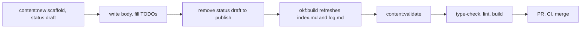

# Publishing content

Use this page when adding or editing anything under `src/content/`. The data model and validator are in [the content bundle](../architecture/content-bundle.md); the contract for agents is [AGENTS.md](../../AGENTS.md); the field reference for authors is [docs/CONTENT.md](../../docs/CONTENT.md). Repository-local agent skills in `.claude/skills/psd401-publish/` hold step-by-step playbooks (`post.md`, `presentation.md`, `ship.md`).

*Drafts are scaffolded, then published by deleting `status: draft`.*

## The loop

1. `bun run content:new -- --type <type> --title "..."` (`scripts/content-new.ts`). Options: `--slug`, `--author`, `--category` (required for `use-case`, because it forms part of the URL), `--maturity` (required for `software`), `--date`, `--tags`, `--description`, `--force`, plus type-specific flags (`--presenters`, `--audience`, `--format`, `--tools`, `--provider`, `--source`, `--stack`). It serialises with js-yaml, computes `resource` from `DIR_TO_URL`, validates against `SCHEMAS[type]` before writing, and refuses to overwrite without `--force`.
2. Write the piece; replace the `TODO` description (it becomes the meta description, search result, RSS entry and `llms.txt` line).
3. Delete `status: draft` to publish. Drafts are excluded from sitemap, `llms.txt`, feed and carry `noindex` ([machine surfaces](../architecture/machine-readable-surfaces.md)).
4. `bun run okf:build` (rewrites `index.md` per directory, the root index and `log.md`), then `bun run content:validate`.
5. Before a PR: `bun run content:validate && bun run type-check && bun run lint && bun run build`, and confirm no placeholder remains: `grep -n 'TODO\|status: draft' src/content/<dir>/<slug>.md`.

## Rules that cause failures

- Slugs are permanent URLs; never rename. Use-case category strings are URL-encoded into the path and must not be "tidied".
- Cross-link with bundle-absolute markdown paths (`/guidance/data-security-ai-guidance.md`); the validator errors on unresolved ones. Site-absolute links must hit a known path or a file in `public/`.
- Frontmatter `image`/`thumbnail` must exist under `public/`.
- Use `format`/`maturity`, not `type`/`status`, for genre and tool maturity.
- Provenance: mark agent-drafted work with `generated`; add a `verified` entry with a `human:<id>` actor only for a person who actually reviewed it (`trustTier` is derived, never stored).
- `src/content/` is excluded from Prettier (`.prettierignore`) so the pre-commit hook (`.husky/pre-commit` → `lint-staged`) never reflows authored text.
- Do not hand-edit generated `index.md`/`log.md`, and do not put non-reserved `.md` files in the bundle root.

## Gotcha: the `protocol` type

`content:new` accepts every value in `OKF_TYPES`, but `scripts/content-new.ts` has no `protocol` case, so the generated frontmatter lacks the required `label` and fails its own schema check. Author Open Adaptive District files by copying an existing one ([OAD page](../architecture/open-adaptive-district.md)). The publish skill's type table still lists `protocol`; treat that as stale for scaffolding.

## House style (summary; full text in AGENTS.md)

First person plural, past tense, specific; "you" is another district; sentence-case headings; no emoji; no marketing words from the avoid-list; calls to action name the thing; real numbers or none (counts come from `getCounts()`); failures are first-class content. Photography is generated placeholder work: never attach a generated portrait to a real named byline (see [docs/image-shoot-list.md](../../docs/image-shoot-list.md)).

## Change navigation

- Changing scaffold output: `scripts/content-new.ts`; keep it in step with `src/lib/schemas.ts` or the self-validation fails.
- Changing what counts as valid: `scripts/content-validate.ts` and [the content bundle](../architecture/content-bundle.md).
- Shipping: branch, checks, PR, wait for CI, merge, confirm live (`.claude/skills/psd401-publish/ship.md`); CI details in [CI and deploy](../operations/ci-and-deploy.md).
- Expensive and conditional: `bun run build` is only needed for final pre-PR confirmation or route changes; there are no unit tests, so `content:validate` is the focused check.
